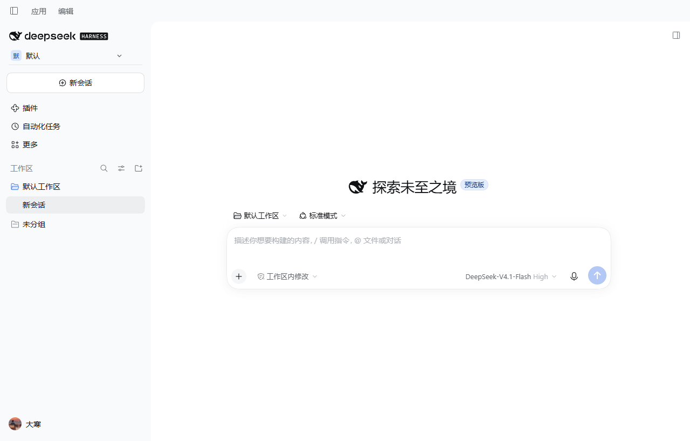
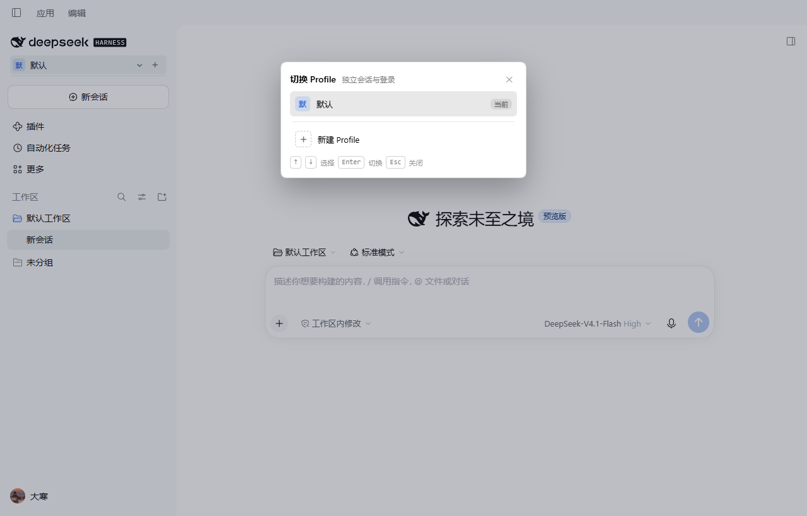

# DSH Desktop Profiles

> 给 DeepSeek Harness 桌面端加**多 Profile**：每个 Profile 拥有独立的 `DSH_HOME`（会话、登录凭据、插件、模型配置、附件），侧边栏一行即可新建/切换；切换在同一窗口完成，**不会中断其它 Profile 正在运行的任务**。






## 为什么需要

DSH 桌面端默认只有一个数据目录：会话、账号、插件、模型设置全在一起。想同时维护「工作 / 个人 / 客户 A」几套完全独立的环境，通常只能反复退出应用、改环境变量、手动搬目录。

本项目把这件事做成侧边栏里的一个下拉：点一下切换，数据完全隔离，**其它 Profile 的任务继续跑**，切回来进度和输出都还在。

## 特性

| 能力 | 说明 |
|---|---|
| 独立数据目录 | 每个命名 Profile 有自己的 `DSH_HOME`：会话历史、定时任务、账号凭据、插件、模型配置、UI 设置、附件、语音模型全部隔离 |
| 原地切换 | 同一窗口切换，过渡页约 1–4 秒，不需要退出应用 |
| 任务不中断 | 每个已启动 Profile 有常驻 Host 子进程；切换只改窗口指向，其它 Profile 的 Agent 继续运行 |
| 新建向导 | 点「＋」填名称/显示名，可勾选「复制当前登录凭据」「沿用当前模型设置」 |
| 删除可恢复 | 删除移入 `.trash`，可手工找回 |
| 命令行 / 环境变量 | `--profile <name>`、`DSH_DESKTOP_PROFILE` 指定启动 Profile；应用已运行时再次执行会切换现有窗口 |
| 升级自愈 | macOS 后台 LaunchAgent（每 20 秒）、Windows 启动 watcher（每 60 秒）检测更新后自动重打补丁；启动器也会在启动前修复 |
| 可回滚 | 安装器保留官方 `app.asar.stock`，一键还原；Profile 数据不受影响 |

## 兼容性

- **DSH Desktop 0.2.2-rc.3 / 0.2.2-rc.5** 已验证：安装器每次都用本机官方 asar 现场构建补丁，不依赖固定哈希。
- 新版 DSH 只要外壳锚点未变，安装与自动修复即可直接适配；锚点变化时安装器会拒绝并保留官方界面。
- Windows 10/11。
- macOS 13+；已在 Apple silicon 真机验证安装、启动与 Profile 切换，签名为 ad-hoc（仅本机可用）。
- 不修改系统设置、不安装后台服务，只改 DSH 应用自身的 `app.asar`。

## 安装

### 方式一：下载 Release（推荐）

到 [Releases](https://github.com/dahan888666-svg/dsh-desktop-profiles/releases) 下载 `dsh-desktop-profiles-<version>-all.zip` 并解压（Windows / macOS 共用同一个包）。更细的步骤见 [INSTALL.md](INSTALL.md)。

#### Windows

1. 双击 **`Install-Windows.cmd`**（自动探测安装目录），或指定路径：

   `Install-Windows.cmd "D:\DSH"`

2. 若 DSH 正在运行，按提示输入 `Y` 关闭（进行中的任务会中断，历史不丢）。
3. 安装器会：只关闭该安装目录的进程 → 备份 `resources\app.asar` → 打补丁 → 把桌面/开始菜单快捷方式指向自愈启动器 → 重新启动应用。
4. 之后请用 **DeepSeek Harness (Profiles)** 快捷方式或 `Launch-Windows.cmd` 启动（DSH 更新后自动重打）。
5. 卸载/回滚：双击 **`Uninstall-Windows.cmd`**。

> `Program Files` 下安装需要管理员权限（安装器会自动请求）；失败时自动回退，日志在 `%LOCALAPPDATA%\dsh-desktop-profiles\repair.log`。

#### macOS

1. 解压后打开「终端」，进入解压目录：

   ```bash
   cd ~/Downloads/dsh-desktop-profiles-0.1.4-all
   chmod +x *.command macos/*.command
   ```

2. 执行安装（默认 `/Applications/DeepSeek Harness.app`）：

   ```bash
   ./install-macos.command
   # 或指定 .app 路径：
   ./install-macos.command "$HOME/Applications/DeepSeek Harness.app"
   ```

   安装器会：退出应用 → 备份 `Contents/Resources/app.asar` → **用这台 Mac 上的官方 asar 现场构建补丁** → 替换 → 同步 `ElectronAsarIntegrity` 哈希 → 按原有 hardened runtime / entitlements 做 ad-hoc 重签名（只签主 bundle）→ `codesign --verify` → 重新打开。

3. 日常用 `launch-macos.command` 启动（可以拖到 Dock）：它会检查补丁，DSH 更新覆盖后自动重建并重打。
4. 卸载/回滚：`./uninstall-macos.command`。

> - 修改 `app.asar` 会让官方 Developer ID 签名失效，安装器会做 **ad-hoc 重签名**：仅本机可用，**不要分发修改后的 .app**。
> - 首次打开若被拦截：右键 → 打开；若提示「应用已损坏」：
>
>   ```bash
>   sudo xattr -dr com.apple.quarantine "/Applications/DeepSeek Harness.app"
>   ```
>
> - 安装会关闭应用一次，进行中的任务会中断（会话历史不丢）。

### 方式二：从源码安装

```bash
git clone https://github.com/dahan888666-svg/dsh-desktop-profiles.git
cd dsh-desktop-profiles
```

**macOS**（用本机官方 asar 现场构建补丁）：

```bash
NODE="/Applications/DeepSeek Harness.app/Contents/Resources/runtime/primary-runtime/dependencies/node/bin/node"
cd macos
"$NODE" tools/build.mjs "$PWD" "/Applications/DeepSeek Harness.app/Contents/Resources/app.asar.stock"
"$NODE" installer/deploy.mjs "/Applications/DeepSeek Harness.app" --payload "$PWD/build/app"
```

首次安装时还没有 `app.asar.stock`，把 build.mjs 的第二个参数换成 `…/Resources/app.asar` 即可；deploy.mjs 会自动生成备份。

**Windows**（仓库自带预构建 payload，直接部署）：

```bat
set NODE=%LOCALAPPDATA%\Programs\DeepSeek Harness\resources\runtime\primary-runtime\dependencies\node\bin\node.exe
"%NODE%" windows\installer\deploy.mjs "D:\DSH" --payload windows\payload
```

> Windows payload 也可以自行重建：`node macos\tools\build.mjs macos "D:\DSH\resources\app.asar.stock"`（build.mjs 与平台无关）。

## 使用

| 操作 | 做法 |
|---|---|
| 切换 | 点侧边栏 Profile 行 → 选择另一个 Profile；当前窗口原地切换 |
| 新建 | 弹窗里「新建 Profile」→ 名称（小写字母/数字/短横线）、显示名 →（可选）复制当前登录凭据 / 沿用模型设置 → 创建并切换 |
| 删除 | 弹窗里悬停非当前项 → ✕ → 移入 `.trash`（可手工恢复） |
| 键盘 | 弹窗内 ↑↓ 选择、Enter 切换、Esc 关闭 |
| 命令行 | `DeepSeek Harness --profile work`；应用已在运行时再次执行会切换到该 Profile |
| 环境变量 | `DSH_DESKTOP_PROFILE=work` 作为默认启动 Profile |

Profile 行位于侧边栏「新会话」上方：头像 + 名称 + 状态点 + 箭头；折叠态只保留头像按钮。

## 数据与隔离

| 数据 | 是否按 Profile 隔离 |
|---|---|
| 会话历史、定时任务 | ✅ |
| 账号 / API 凭据（`.credentials.yaml`） | ✅（新建时默认复制一份，可关闭） |
| 插件、bundle、模型配置 | ✅ |
| UI 设置、附件、语音模型、运行缓存 | ✅ |
| Electron 缓存、更新记录 | ❌ 全局共享 |
| 平台网站 cookie、Web 前端 localStorage | ❌ 共享（会话与账号凭据已隔离） |

目录布局：

```
<DSH_HOME>                     # Windows: %USERPROFILE%\.dsh   macOS: ~/.dsh
├─ sessions\ .credentials.yaml …   # 默认 Profile（原样，不迁移）
├─ profiles\desktop\               # 默认 Profile 的插件配置
└─ desktop-profiles\               # 新增
   ├─ registry.json                 # Profile 注册表 + 上次使用
   ├─ work\{meta.json, home}       # 命名 Profile（home 是完整 DSH_HOME）
   └─ .trash\<时间>-<name>\         # 删除的 Profile（可恢复）
```

## 卸载 / 回滚

- **Windows**：`Uninstall-Windows.cmd` → 还原官方 `app.asar` 并重启。
- **macOS**：`uninstall-macos.command` → 还原官方 `app.asar`、重算 `ElectronAsarIntegrity`、ad-hoc 重签并重启。
- 两种方式都**不会删除 Profile 数据**（仍在 `desktop-profiles` 下）；想彻底清理，卸载后手动删除该目录。

## DSH 升级后（自动修复）

官方更新会用新的 `app.asar` 覆盖补丁。0.1.4 起两个平台都带**后台自动修复**：

- **macOS**：安装器注册 LaunchAgent `com.dsh.desktop-profiles.repair`，每 **20 秒**检查一次。发现补丁丢失时，用新 `app.asar` 现场构建、替换、同步 `ElectronAsarIntegrity`、ad-hoc 重签，并发系统通知。
- **Windows**：安装器把工具链复制到 `%LOCALAPPDATA%/dsh-desktop-profiles/toolchain`，并在启动文件夹放一个隐藏 watcher，每 **60 秒**检查；`Launch-Windows.cmd` / `Repair-Windows.cmd` 启动前也会先修复。

修复完成后需要**重启一次应用**才能看到 Profile 行（更新重启时应用可能先以官方界面启动，后台随后完成修复）。日志：

- macOS：`~/Library/Logs/dsh-desktop-profiles/repair.log`
- Windows：`%LOCALAPPDATA%/dsh-desktop-profiles/repair.log`

如果 DSH 新版改了外壳结构导致锚点失效，自动修复会失败并**保持官方界面**（不会写坏应用），日志里会给出原因；此时需要更新 `macos/src/blocks` 与 `build.mjs` 锚点后发布新版。

卸载会先移除后台修复，再恢复官方 `app.asar`，不会出现「刚卸载又被重打」。


## 工作原理

DSH 的插件（bundle）运行在 Host / Web Client 里，**改不了 Electron 外壳**，所以本项目以「源码 + 安装器」分发：安装器修改 `resources/app.asar` 中的外壳 JS，并新增少量文件。

| 文件 | 作用 |
|---|---|
| `lib/main.js` | Profile 注册表/目录布局、每个 Profile 一个 Host、切换 IPC、`--profile` 与第二实例切换 |
| `lib/preload-app.cjs` | 向渲染层暴露 `profiles.list/create/switch/remove/rename` 与变更订阅 |
| `dsh/node_modules/@deepseek-ai/dsh-client-ui-sidebar/lib/client.js` | 侧边栏 Profile 行（无边框身份行 + 切换弹窗） |
| `lib/profiles.js`（新增） | 注册表、目录布局、创建/删除/回收站 |
| `renderer/switch.html`（新增） | 切换过渡页 |
| `lib/desktop-profile-template.json`（新增） | 新建 Profile 的初始 bundle 列表 |

每个已启动 Profile 常驻一个 Host 子进程（约 +300 MB 私有内存/个）。切换只改变窗口指向，不停止其它 Host，所以任务不中断；切回时页面重新连回同一个 Host。

macOS 额外处理：替换 `app.asar` 后同步 `Info.plist` 的 `ElectronAsarIntegrity` 哈希，并以原有 hardened runtime / entitlements 做 ad-hoc 重签（`macos/installer/macos-sign.mjs`）。

## 仓库结构

```
dsh-desktop-profiles/
├─ Install-Windows.cmd / Launch-Windows.cmd / Repair-Windows.cmd / Uninstall-Windows.cmd
├─ install-macos.command / launch-macos.command / uninstall-macos.command
├─ windows/
│  ├─ Install.cmd / Launch.cmd / Repair.cmd / Uninstall.cmd
│  ├─ installer/      # repair / deploy / revert / asar / ps1 / watcher
├─ macos/
│  ├─ install.command / launch.command / uninstall.command
│  ├─ installer/      # deploy / revert / asar / macos-sign
│  ├─ agent/          # 后台自动修复（LaunchAgent）
│  ├─ src/            # 补丁源码（两个平台共用）
│  └─ tools/          # build.mjs / asar.mjs
├─ plugin/            # 可选的 DSH bundle 载体（状态检测）
├─ docs/              # 截图与预览
└─ README.md / INSTALL.md / CHANGELOG.md / VERSION / LICENSE
```

## 开发与构建

- 补丁源：`macos/src/blocks/host-block.js`（多 Host）、`switch-block.js`（切换 IPC）、`sidebar-profile-bar.js`（侧边栏组件），以及 `src/profiles.js`、`src/switch.html`。
- `macos/tools/build.mjs`：读取官方 `app.asar` + `src/`，生成 `build/app` 与 `dsh-profile-patch.json` 清单；锚点缺失会明确报 `anchor not found`。
- `macos/installer/deploy.mjs`：校验 `stockMainSha256` → 从官方备份重打包 → 备份 `app.asar.stock` → 替换 →（macOS）同步哈希、重签、校验。
- `macos/installer/revert.mjs`：还原官方 asar，并按同一规则恢复哈希与签名。
- `macos/installer/asar.mjs`：最小 asar 读写实现；未修改的文件按原始字节复制，重打包不引入额外差异。
- 版本号：`macos/VERSION` 会被 build.mjs 写进补丁清单（`patchVersion`）。
- 自动修复：`macos/agent/`（LaunchAgent + `repair.mjs`）与 `windows/installer/repair.mjs`（watcher / 启动器共用），检测补丁丢失后调用同一套 build + deploy。

## 已知限制

- 同一时刻只显示一个窗口；Profile 通过切换访问。
- 插件不跨 Profile 共享；平台网站 cookie 与 Web 前端 localStorage 仍共享。
- 空闲 Profile 的 Host 暂不自动回收（重启应用释放）。
- macOS 修改后为 ad-hoc 签名：仅本机可用，自动更新（electron-updater）可能因签名校验失败，升级请走官方 App。
- DSH 升级会覆盖补丁，需要自愈启动器或重新安装。

## 安全与边界

- 安装器只修改 `resources/app.asar`，并保留 `app.asar.stock` / `app.asar.previous` 备份；不改系统设置、不装服务。
- 分发包不包含任何 DeepSeek Harness 官方二进制，只包含补丁源码与安装脚本。
- 安装后的 App 仍以你的用户权限运行；请只从本仓库或可信来源获取补丁。

## FAQ

**装完侧边栏没有 Profile 行？**
确认重启过应用；确认用的是新安装的 `app.asar`（Windows 看安装目标目录，macOS 看是否被官方更新覆盖）——用自愈启动器再启动一次。

**macOS 提示「应用已损坏，无法打开」？**
`sudo xattr -dr com.apple.quarantine "/Applications/DeepSeek Harness.app"`，或右键 → 打开。

**macOS 双击 `.command` 没反应 / 没有访问权限？**
`chmod +x *.command macos/*.command` 后再试；或在终端 `./install-macos.command`。从网络下载的包可能带 quarantine，可用 `xattr` 清除。

**提示 `unsupported DSH build` 或 `anchor not found`？**
DSH 版本与补丁不匹配。在 Mac 上重跑安装会按本机 asar 重建；仍失败说明外壳代码变化，需要适配 `src/blocks`。

**能同时开官方 App 和打了补丁的 App 吗？**
不能，两者共用同一份 Electron 用户数据 / 单实例锁；同一时间只运行一个。

**插件（plugin/）和安装器是什么关系？**
插件只是 bundle 载体，负责启动时报告补丁版本；真正改外壳的是根目录的安装器。

**Profile 数据在哪？想彻底删除？**
见「数据与隔离」；删除 `<DSH_HOME>/desktop-profiles` 即彻底清除。

## 许可证

MIT，见 [LICENSE](LICENSE)。

## 致谢

多 Profile 的产品形态参考了 [Nous Research Hermes](https://nousresearch.com/) 的 Profile 体验；本项目以 DeepSeek Harness 桌面壳补丁的方式实现。
